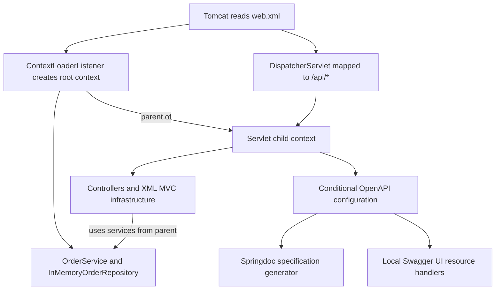
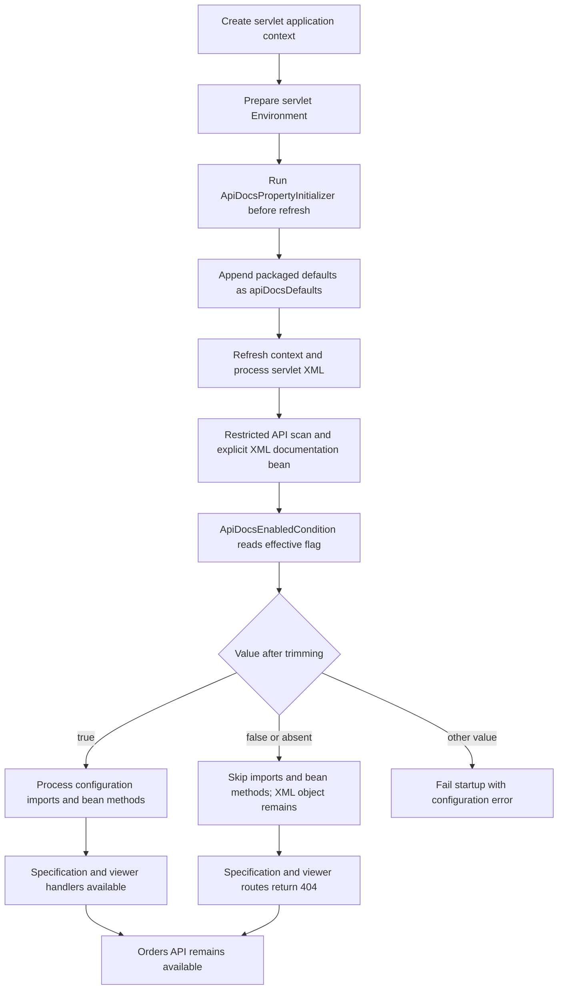
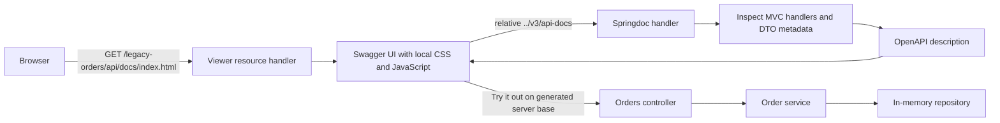
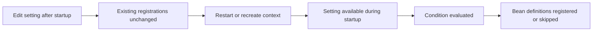

# Application architecture

This standalone sample adds OpenAPI to an XML-configured Spring MVC WAR. It keeps application startup under Tomcat and Spring Framework. Springdoc uses Boot support libraries internally; there is no Boot application entry point or Boot MVC startup.

## Context ownership



[root-context.xml](../src/main/webapp/WEB-INF/root-context.xml) scans only the `order` package. [orders-servlet.xml](../src/main/webapp/WEB-INF/orders-servlet.xml) scans only `api`, with `use-default-filters="false"` and explicit annotation filters for `Controller` and `ControllerAdvice`. Meta-annotation matching includes `@RestController` and the existing `@RestControllerAdvice`. The advice filter preserves the current JSON error contract without adding another advice class.

The child resolves `OrderService` and `InMemoryOrderRepository` from the parent, without registering local copies. The root cannot resolve controllers, advice, or documentation beans defined only in its child. These contexts are not separate processes. Tests assert local bean counts, identical inherited service instances, failed parent lookups for child beans, and no overlapping application bean names.

XML remains the owner of MVC. The named `mvcConversionService` is shared with springdoc, avoiding a second MVC registration. Viewer resource handlers are explicit beans because XML MVC does not invoke `WebMvcConfigurer` callbacks.

## Startup and the flag



The initializer is declared as a DispatcherServlet `contextInitializerClasses` init parameter in [web.xml](../src/main/webapp/WEB-INF/web.xml). It prepares that child context before `refresh()` processes the XML. It is not registered by component scanning, and it does not wait for ordinary application beans to be instantiated.

The initializer adds a low-priority classpath property source. Existing sources such as JVM system properties remain earlier in the lookup order. The condition then reads the effective value; it performs no file or database I/O.

Failure to load the packaged file aborts startup in the initializer. A malformed flag aborts startup in the condition. A missing flag defaults to false. With the supplied resource and no override, the value is explicitly false.

## Request paths

`web.xml` is the servlet-container deployment descriptor: Tomcat uses it to create `ContextLoaderListener` and `DispatcherServlet`, select their XML files, attach the initializer, and route `/api/*`. `orders-servlet.xml` is Spring bean configuration for that servlet's child context. Its component scan does not choose a servlet URL.

| Mechanism | Responsibility | Example |
|---|---|---|
| Servlet mapping | Route HTTP requests to the servlet | `/api/*` in `web.xml` |
| Component scanning | Discover eligible bean classes in a context | `api` package and controller/advice annotation filters |
| Springdoc API filtering | Select registered handlers for the generated description | `packagesToScan=dev.kavrin.legacyorders.api`, `pathsToMatch=/orders,/orders/**` |

Springdoc filtering neither creates controller beans nor prevents requests to excluded business handlers. Operation paths are relative to the servlet; the `/api` prefix belongs in the server base.



The WAR context is `/legacy-orders`, the servlet mapping is `/api/*`, and the operation path is `/orders`. The generated server base includes `/legacy-orders/api`. Specification generation inspects metadata; fetching it does not execute order creation. UI execution sends actual requests to this fictional API.

## Decision: register documentation explicitly

The `docs` package is a sibling of `api`, outside the scanned hierarchy. XML declares its configuration directly:

```xml
<bean id="apiDocsConfiguration" class="dev.kavrin.legacyorders.docs.ApiDocsConfiguration"/>
```

`@Configuration` alone does not cause discovery. A class must first be registered, imported, or selected by a scan. Here it is outside the scanned package; even inside that package, a plain `@Configuration` would not match the controller/advice filters. Broadening both the scan hierarchy and filters could pull unrelated services or infrastructure into the MVC context. Explicit registration adds this one configuration while preserving the scan boundary.

The `context:component-scan` element enables annotation processors even when its default discovery filters are disabled. `ConfigurationClassPostProcessor` therefore processes the XML-declared class, including its condition, imports, and bean methods. A false condition skips its contributions, but the ordinary XML-declared configuration object remains. This differs from scanning, where a false condition prevents discovery of the configuration bean itself. Explicit registration therefore preserves endpoint gating, with an inert configuration object in the disabled state. Tests assert both this object and the absence of its documentation contributions. See the [Spring 5.3 configuration API](https://docs.spring.io/spring-framework/docs/5.3.39/javadoc-api/org/springframework/context/annotation/Configuration.html) and [conditional API](https://docs.spring.io/spring-framework/docs/5.3.39/javadoc-api/org/springframework/context/annotation/Conditional.html).

## Decision: keep loading separate from matching

Recorded on 15 October 2026. Keep `ApiDocsPropertyInitializer` and `ApiDocsEnabledCondition` as separate classes.

| Concern | Owner |
|---|---|
| Find and load packaged defaults | Initializer |
| Establish fallback precedence | Initializer and Environment property-source order |
| Resolve the effective setting | Environment |
| Validate the boolean and permit registration | Condition |
| Define generator and viewer beans | Documentation configuration |

Direct file loading inside `matches` is possible. We retain the initializer so property-loading mechanics have an explicit lifecycle hook and the condition remains a short decision based on already-available configuration. Conditions can be evaluated more than once during configuration processing; keeping I/O outside `matches` also avoids repeated loading there.

The cost is one class and one servlet init parameter. For a sample intended to teach lifecycle and configuration, that separation is worth keeping. It is not a claim that every one-property application needs an initializer.

The generic alternative of an existing database-backed settings system is discussed only as a configuration source. This project does not include a database reader, an enterprise setting name, or a production settings schema. A condition should not instantiate application services or start a database lookup during bean-definition processing.

## Startup state is not live switching



The Environment can resolve a changed source value when asked again, but that does not cause Spring to rerun the condition and rebuild registrations. Documentation gating is also not authentication: it controls feature availability, and the orders API has no caller authentication in this local sample.

## Evidence and boundaries

The [verification notes](VERIFICATION.md) record context and MockMvc checks plus real packaged-WAR HTTP checks in both flag states. The suite checks inferred schemas and actual validation separately. It also demonstrates a missing-order JSON 404 that is not automatically documented in the generated operation.

Data is held in memory and lost on restart. External Tomcat installation, proxy configuration, production deployment, and a database-backed loader are outside the executed evidence.

## Primary references

- [Spring 5.3 ApplicationContextInitializer](https://docs.spring.io/spring-framework/docs/5.3.39/javadoc-api/org/springframework/context/ApplicationContextInitializer.html)
- [Spring 5.3 StandardServletEnvironment](https://docs.spring.io/spring-framework/docs/5.3.39/javadoc-api/org/springframework/web/context/support/StandardServletEnvironment.html)
- [Spring 5.3 Condition](https://docs.spring.io/spring-framework/docs/5.3.39/javadoc-api/org/springframework/context/annotation/Condition.html)
- [Springdoc v1 non-Boot integration](https://springdoc.org/v1/faq.html)
