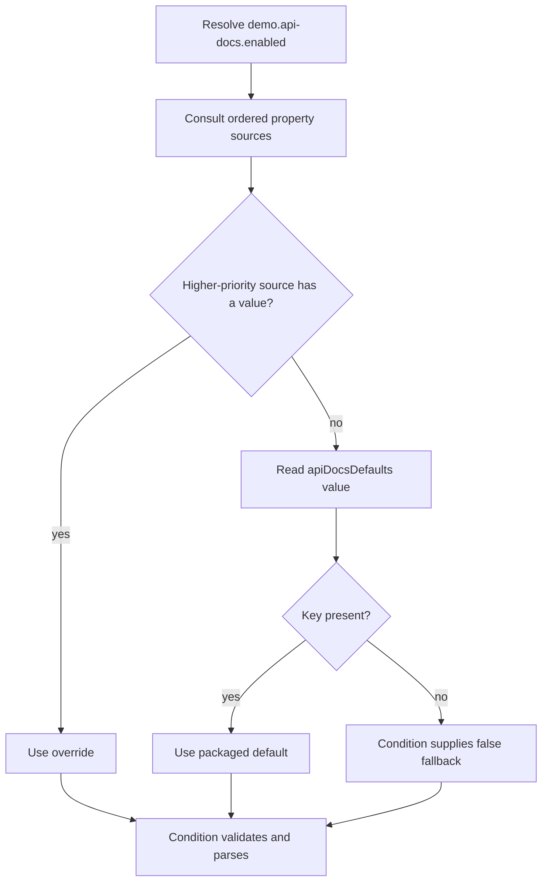

# Lesson 2: Environment and property sources

Spring's `Environment` provides property resolution and profile information. It is not a properties file. It can consult several ordered `PropertySource` objects to answer a question such as `getProperty("demo.api-docs.enabled")`. [Spring Environment API](https://docs.spring.io/spring-framework/docs/5.3.39/javadoc-api/org/springframework/core/env/Environment.html)

## How a lookup works

For a key present in multiple sources, resolution uses the first applicable value in source order. The initializer appends the packaged file, so a JVM system property takes precedence over that file.



This is the sample's relevant lookup path, not a complete universal precedence list. `StandardServletEnvironment` also supports servlet init parameters, servlet-context parameters, and JNDI. Its standard sources include JVM properties and operating-system environment variables. `addLast` preserves sources ahead of the packaged file, rather than giving JVM properties unconditional precedence over every possible source. [Servlet Environment API](https://docs.spring.io/spring-framework/docs/5.3.39/javadoc-api/org/springframework/web/context/support/StandardServletEnvironment.html)

## Three similarly named things

| Term | Meaning in this project |
|---|---|
| JVM system property | A JVM key/value, such as one passed with `-Ddemo.api-docs.enabled=true` |
| Operating-system environment variable | A value inherited from the process environment |
| Spring Environment | The abstraction that resolves values from its configured sources |

Putting something in the Spring Environment does not call `System.setProperty` or modify the operating system's environment. The initializer adds a Spring property source local to the context being prepared.

## File name and packaging

[api-docs.properties](../../src/main/resources/api-docs.properties) contains the default. Plain Spring does not load a file merely because it is named `application.properties`, and renaming our file to that name would not replace the initializer's explicit registration.

The Maven WAR build packages this resource at:

```text
WEB-INF/classes/api-docs.properties
```

The application loads it through the classpath. Changing the packaged default normally requires rebuilding/redeploying. A deployment JVM override lets the same WAR start in either mode. [Maven WAR resources](https://maven.apache.org/plugins/maven-war-plugin/examples/adding-filtering-webresources.html)

## Experiment: same WAR, two startups

Build once, then run each command separately, stopping the first process before the second:

```sh
./mvnw verify
./mvnw -Ddemo.api-docs.enabled=false exec:java
./mvnw -Ddemo.api-docs.enabled=true exec:java
```

The first startup serves orders but not documentation. The second also serves `/legacy-orders/api/docs/index.html` and the specification endpoints. For an external Tomcat installation, put the override on the Tomcat JVM. Passing it only to a Maven packaging command does not bake it into the WAR.

To inspect the actual source ordering at a debugger breakpoint:

```java
context.getEnvironment().getPropertySources()
```

Inspect only the source names and this sample flag. Dumping all properties of an unrelated application can reveal credentials and other private configuration.

## Recall questions

1. Why does `addLast` keep the file from overriding a JVM value?
2. Does the Environment contain only environment variables?
3. Does the packaged properties file change when Maven receives a `-D` argument?

### Check your reasoning

1. Property lookup checks earlier sources first; the file is appended as a fallback.
2. No. It resolves across registered sources and also exposes profile information.
3. No. This project configures no resource filtering that writes that flag into the file. The deployment JVM must receive the runtime override.

Continue with [conditions and startup decisions](03-conditions.md).
