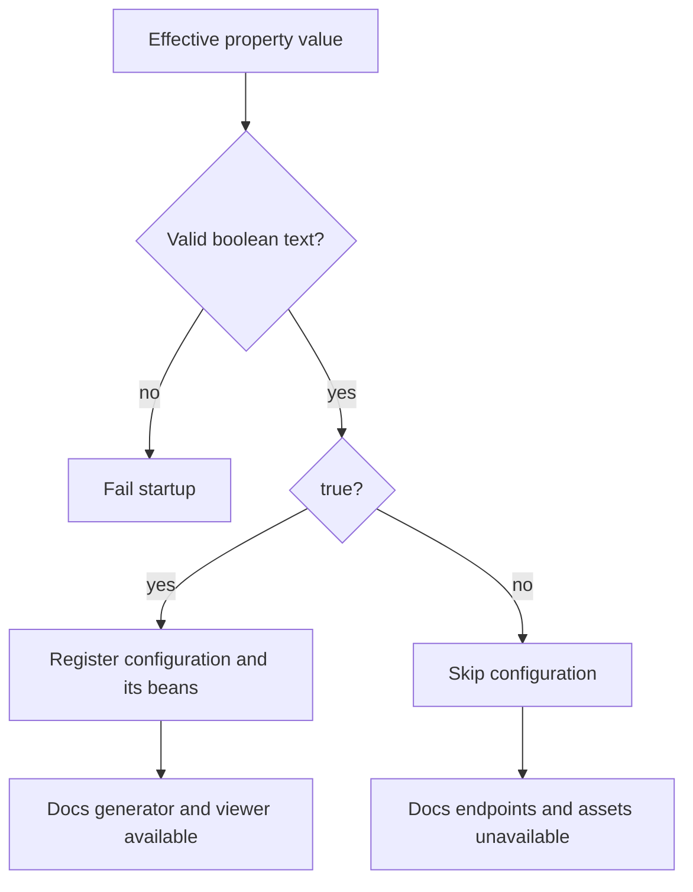

# Lesson 3: conditions and startup decisions

A Spring `Condition` decides whether an annotated component can be registered. It runs during definition processing, before that candidate becomes an ordinary application bean. It is not a request interceptor and is not automatically reevaluated when settings change. [Spring 5.3 Condition API](https://docs.spring.io/spring-framework/docs/5.3.39/javadoc-api/org/springframework/context/annotation/Condition.html)

## Read the sample's decision

[ApiDocsConfiguration](../../src/main/java/dev/example/legacyorders/docs/ApiDocsConfiguration.java) is annotated with:

```java
@Conditional(ApiDocsEnabledCondition.class)
```

The servlet component scan considers this class. [ApiDocsEnabledCondition](../../src/main/java/dev/example/legacyorders/docs/ApiDocsEnabledCondition.java) reads the effective value:

```java
String value = context.getEnvironment()
        .getProperty(PROPERTY, "false").trim();
```

It accepts `true` and `false` without regard to case. Other explicit values cause a configuration error rather than silently behaving as false.



When skipped, the sample has no documentation configuration bean, no imported generator configuration from that class, and no viewer mappings from that class. The existing orders controller belongs to a separate package and remains registered.

## What matches receives

`matches` receives `ConditionContext` and `AnnotatedTypeMetadata`. The first exposes facilities such as the Environment and resource loader; the second describes the candidate annotation metadata. A condition is instantiated by configuration-processing machinery, so do not assume normal application-bean constructor or field injection.

Although the context exposes bean-factory information, Spring's condition contract says not to interact with bean instances. Calling `getBean` can trigger premature initialization. A database-backed setting must not become an excuse to instantiate a service and perform a database query from this condition.

An already-prepared external settings source can supply configuration before this decision point. A value held by an already-refreshed parent context has different lifecycle circumstances from an uninitialized local bean, but accessing bean instances from a condition is still not the general pattern recommended by Spring's contract. The sample deliberately uses the Environment to avoid that coupling.

## Why the initializer stays separate

The [architecture decision](../ARCHITECTURE.md#decision-keep-loading-separate-from-matching) keeps file loading and property precedence in the initializer. The condition validates and decides. A small direct file-reading condition could also work; the separation is retained to make startup ordering explicit and keep I/O out of a callback that may run multiple times.

The initializer is not required because Spring forbids file access in `matches`. It is an engineering choice for this sample, and its extra class/init parameter is a real cost.

## Experiment: changing a value is not rebuilding a context

Run the existing case:

```sh
./mvnw '-Dtest=DocumentationIntegrationTest#changingAPropertyAfterStartupDoesNotCreateDocumentationBeans' test
```

It starts with documentation disabled, adds a higher-priority true value after refresh, and verifies that the documentation endpoint still returns 404 and its configuration bean remains absent. The Environment has changed; the registered bean definitions have not.

The full suite also checks invalid input and both flag states. Each mode should preserve order creation, retrieval, and validation. The WAR tests verify the actual servlet prefix over HTTP rather than relying only on bean assertions.

## Recall questions

1. Why does changing the property after startup not enable documentation?
2. Does false remove documentation dependency JARs from the WAR?
3. Does hiding Swagger UI protect the orders API?
4. Must the initializer be separate for Spring to support the condition?

### Check your reasoning

1. A condition gates registration during startup. Property mutation does not rerun configuration processing or rebuild the context.
2. No. Packaging and bean registration are different stages.
3. No. Documentation availability and caller authentication are separate concerns. UI submission settings also do not secure API requests.
4. No. The separation is an explicit design choice here, documented with its benefits and cost.

Return to the [documentation index](../README.md).
